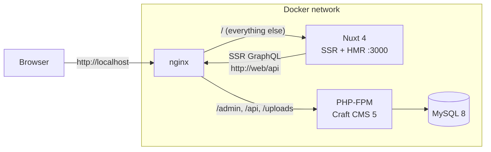

# craft-nuxt-starter

**Craft CMS 5 + Nuxt 4, headless, already wired together.**

One command gives you a running stack: Craft in headless mode with GraphQL, a server-rendered Nuxt 4 frontend, live preview, Docker networking that actually works, and seeded demo content — so you start from *working*, not from a blank page.

[](https://github.com/Fildes3d3/craft-nuxt-starter/actions/workflows/ci.yml)
[](https://craftcms.com)
[](https://nuxt.com)
[](https://vuejs.org)
[](LICENSE)

---

## Quickstart

Requirements: [Docker Desktop](https://www.docker.com/products/docker-desktop/) (or Docker Engine + Compose v2) and `make`.

```bash
git clone https://github.com/Fildes3d3/craft-nuxt-starter.git
cd craft-nuxt-starter
make setup
```

That's it. The first run takes a few minutes (image builds + dependency installs), then:

| URL | What |
|---|---|
| http://localhost | Nuxt frontend (SSR, with HMR in dev) |
| http://localhost/blog | Blog listing from the seeded channel |
| http://localhost/admin | Craft control panel — `admin` / `password` |
| http://localhost/admin/graphiql | GraphiQL schema explorer |
| http://localhost/api | GraphQL endpoint (public schema) |

Edit the Home entry in the control panel, hit save, refresh `localhost`. That round trip is the whole development loop.

## What `make setup` actually does

1. Copies `.env.example` → `.env` for root, backend, and frontend (skips existing)
2. Builds and starts four containers: **MySQL 8**, **PHP-FPM** (Craft), **Node** (Nuxt dev server), **nginx** (single entry point on port 80)
3. `composer install` from the committed lock file
4. Generates a Craft security key and installs Craft non-interactively
5. Applies the project config — sections, fields, entry types, GraphQL schema all come from YAML in `backend/config/project/`
6. Seeds demo content: a Home page built from matrix blocks, an About page, two blog posts

Idempotent — safe to run again. `make nuke` wipes the database for a true fresh start.

## Architecture



The detail that matters: **server-side rendering queries GraphQL over the internal Docker network** (`http://web/api`), while the browser uses the public URL (`http://localhost/api`). This split avoids hairpin-NAT and SSL issues that bite most headless setups in production — and it's controlled entirely by two env vars.

## Project structure

```
├── docker-compose.yml        # the whole dev stack
├── Makefile                  # make setup / up / down / logs / craft c="…"
├── docker/                   # php-fpm, nginx, nuxt images
├── backend/                  # Craft CMS 5
│   ├── config/project/       # content model as YAML — version-controlled
│   ├── scripts/seed.php      # idempotent demo content seeder
│   └── composer.json
└── frontend/                 # Nuxt 4
    └── app/
        ├── composables/
        │   ├── useCraftQuery.ts    # minimal GraphQL client (SSR-aware)
        │   └── usePreviewToken.ts  # Craft live-preview token handling
        ├── components/blocks/      # one component per matrix block type
        ├── queries/content.ts      # GraphQL documents
        ├── types/content.ts        # typed payloads
        └── pages/
            ├── index.vue           # Home single
            ├── [slug].vue          # Pages structure
            └── blog/               # Blog channel (listing + detail)
```

## Content model

Three sections, designed to be extended rather than replaced:

| Section | Type | Routing | Entry type |
|---|---|---|---|
| **Home** | Single | `/` | Page (title + content blocks) |
| **Pages** | Structure | `/{slug}` | Page (title + content blocks) |
| **Blog** | Channel | `/blog/{slug}` | Post (title, excerpt, image, body) |

**Content blocks** is a matrix field with three block types — Hero (heading + text), Text (CKEditor rich text), and Image (asset + caption). Add a new block type in Craft, add a case to `ContentBlocks.vue`, done.

The entire model lives in `backend/config/project/` as YAML. Change something in the control panel and the YAML updates; commit it and teammates get it via `make craft c="project-config/apply"`. This is [Craft's project config](https://craftcms.com/docs/5.x/system/project-config.html) — the starter just ships with a working one.

## Querying content

```ts
// any page component
const { query } = useCraftQuery()

const { data, error } = await useAsyncData('home', () =>
  query<PageData>(homeGql),
)
```

Two patterns here are deliberate, learned from running this stack in production:

1. **Always wrap queries in `useAsyncData`.** A raw `await query()` in `<script setup>` gets swallowed by `<Suspense>` when it throws — you get a blank page with no error. `useAsyncData` surfaces errors properly and dedupes the payload into Nuxt's hydration data.

2. **`NUXT_` prefix on private runtime config.** `gqlApiHostServer` is private runtime config, which means the env var that overrides it at runtime **must** be named `NUXT_GQL_API_HOST_SERVER`. Plain `GQL_API_HOST_SERVER` silently does nothing. This one costs hours when you hit it unprepared.

## Live preview

Already wired. In Craft, open any entry and hit **Preview** — the Nuxt frontend renders the draft. How it works:

- Craft appends `?token=…` to the preview URL
- `usePreviewToken()` reads it (and persists it in a short-lived cookie for client-side navigation)
- `useCraftQuery()` forwards it as the `X-Craft-Token` header, so GraphQL serves draft content

## Day-to-day commands

```bash
make up            # start
make down          # stop
make logs          # all logs
make logs-nuxt     # just the Nuxt dev server
make shell-php     # bash inside the PHP container
make craft c="clear-caches/all"   # any Craft console command
make lint          # ESLint (inside the container — no host Node needed)
make typecheck     # vue-tsc full type check (strict mode)
make test          # Vitest suite (components + composables)
make nuke          # delete everything incl. database, start over
```

Linting (`@nuxt/eslint` flat config), type checking (`vue-tsc`, strict mode via Nuxt's generated tsconfig), and tests (Vitest + `@nuxt/test-utils`) all run in CI on every push and pull request.

## Troubleshooting

**Blank page, no error, but GraphQL works in GraphiQL** — you're probably `await`ing a query without `useAsyncData`. See [Querying content](#querying-content).

**SSR can't reach GraphQL but the browser can** — the SSR endpoint must be reachable *from inside the Nuxt container*. Use the internal service URL (`http://web/api`), never `localhost` (that's the container itself) and ideally not your public HTTPS domain (hairpin NAT).

**Changed `nuxt.config.ts` but nothing happened** — restart the Nuxt container: `docker compose restart nuxt`. Config isn't hot-reloaded.

**Port 80 or 3000 already taken** — stop whatever owns it, or change the published ports in `docker-compose.yml` (and the URLs in the root `.env` — inside Docker those env vars override `frontend/.env`).

**`make setup` fails at composer with security advisories** — your clone is old and the locked Craft version has since had advisories published. Run `make shell-php`, then `composer update --working-dir=/app/backend`, then `php /app/backend/craft up`.

## Production

This starter is deliberately scoped to local development. If you take it to production, the short version of what changes: build the Nuxt image with `target: prod` (already in the Dockerfile), put real secrets in the env files, terminate SSL at your proxy, and keep the SSR GraphQL URL on the internal network.

## License

[MIT](LICENSE) — use it for anything.

---

Built by [Adrian Bogdan Pop](https://popadrianbogdan.com) — Craft CMS & Nuxt contractor. This starter is the distilled setup behind [popadrianbogdan.com](https://popadrianbogdan.com).
