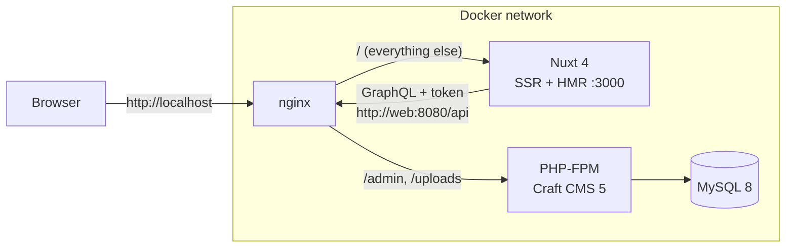

# craft-nuxt-starter

**Craft CMS 5 + Nuxt 4, headless, already wired together.**

One command gives you a running stack: Craft in headless mode with GraphQL, a server-rendered Nuxt 4 frontend, live preview, Docker networking that actually works, and seeded demo content — so you start from *working*, not from a blank page.

Craft's GraphQL is **not public**: only the Nuxt server can query it, with a private-schema token. See [Security](#security).

[](https://github.com/Fildes3d3/craft-nuxt-starter/actions/workflows/ci.yml)
[](https://craftcms.com)
[](https://nuxt.com)
[](https://vuejs.org)
[](LICENSE)

---

## Quickstart

Requirements: [Docker Desktop](https://www.docker.com/products/docker-desktop/) (or Docker Engine + Compose v2) and `make`.

```bash
git clone https://github.com/Fildes3d3/craft-nuxt-starter.git
cd craft-nuxt-starter
make setup
```

That's it. The first run takes a few minutes (image builds + dependency installs), then:

| URL | What |
|---|---|
| http://localhost | Nuxt frontend (SSR, with HMR in dev) |
| http://localhost/blog | Blog listing from the seeded channel |
| http://localhost/admin | Craft control panel — `admin` / `password` |
| http://localhost/admin/graphiql | GraphiQL schema explorer (pick the "Nuxt (server only)" schema) |

Edit the Home entry in the control panel, hit save, refresh `localhost`. That round trip is the whole development loop.

## What `make setup` actually does

1. Copies `.env.example` → `.env` for root, backend, and frontend (skips existing)
2. Builds and starts four containers: **MySQL 8**, **PHP-FPM** (Craft), **Node** (Nuxt dev server), **nginx** (single entry point on port 80)
3. `composer install` from the committed lock file
4. Generates a Craft security key and installs Craft non-interactively
5. Applies the project config — sections, fields, entry types, GraphQL schemas all come from YAML in `backend/config/project/`
6. Creates a token for the private "Nuxt (server only)" GraphQL schema and writes it to the root `.env` as `GQL_TOKEN` (`make gql-token`)
7. Seeds demo content: a Home page built from matrix blocks, an About page, two blog posts

Idempotent — safe to run again. `make nuke` wipes the database for a true fresh start.

## Architecture



Two details matter:

- **Only the Nuxt server talks to Craft.** During SSR it queries GraphQL over the internal Docker network (`http://web:8080/api`, an nginx server block that isn't published), which avoids the hairpin-NAT and SSL issues that bite most headless setups in production.
- **The browser never talks to Craft.** On client-side navigation it posts an operation name to Nuxt's `/_gql` route, and the Nuxt server runs the matching query from an allowlist.

## Project structure

```
├── docker-compose.yml        # the whole dev stack
├── Makefile                  # make setup / up / down / logs / craft c="…"
├── docker/                   # php-fpm, nginx, nuxt images
├── backend/                  # Craft CMS 5
│   ├── config/project/       # content model as YAML — version-controlled
│   ├── scripts/seed.php      # idempotent demo content seeder
│   └── composer.json
└── frontend/                 # Nuxt 4
    ├── app/
    │   ├── composables/
    │   │   ├── useCraftQuery.ts    # minimal GraphQL client (SSR-aware)
    │   │   └── usePreviewToken.ts  # Craft live-preview token handling
    │   ├── components/blocks/      # one component per matrix block type
    │   ├── queries/content.ts      # named GraphQL operations
    │   ├── types/content.ts        # typed payloads
    │   └── pages/
    │       ├── index.vue           # Home single
    │       ├── [slug].vue          # Pages structure
    │       └── blog/               # Blog channel (listing + detail)
    └── server/
        ├── routes/_gql.post.ts     # browser → Craft, allowlisted operations only
        └── utils/gqlOps.ts         # the allowlist
```

## Content model

Three sections, designed to be extended rather than replaced:

| Section | Type | Routing | Entry type |
|---|---|---|---|
| **Home** | Single | `/` | Page (title + content blocks) |
| **Pages** | Structure | `/{slug}` | Page (title + content blocks) |
| **Blog** | Channel | `/blog/{slug}` | Post (title, excerpt, image, body) |

**Content blocks** is a matrix field with three block types — Hero (heading + text), Text (CKEditor rich text), and Image (asset + caption). Add a new block type in Craft, add a case to `ContentBlocks.vue`, done.

The entire model lives in `backend/config/project/` as YAML. Change something in the control panel and the YAML updates; commit it and teammates get it via `make craft c="project-config/apply"`. This is [Craft's project config](https://craftcms.com/docs/5.x/system/project-config.html) — the starter just ships with a working one.

## Querying content

```ts
// any page component
const { query } = useCraftQuery()

const { data, error } = await useAsyncData('home', () =>
  query<PageData>(getHomeGql()),
)
```

Each query is a named operation built in `app/queries/content.ts`. To add one, write its builder there and register it in `server/utils/gqlOps.ts` with a validator for its variables. The browser can only run operations listed there.

Two patterns here are deliberate, learned from running this stack in production:

1. **Always wrap queries in `useAsyncData`.** A raw `await query()` in `<script setup>` gets swallowed by `<Suspense>` when it throws — you get a blank page with no error. `useAsyncData` surfaces errors properly and dedupes the payload into Nuxt's hydration data.

2. **`NUXT_` prefix on private runtime config.** `gqlApiHostServer` is private runtime config, which means the env var that overrides it at runtime **must** be named `NUXT_GQL_API_HOST_SERVER`. Plain `GQL_API_HOST_SERVER` silently does nothing. This one costs hours when you hit it unprepared.

## Live preview

Already wired. In Craft, open any entry and hit **Preview** — the Nuxt frontend renders the draft. How it works:

- Craft appends `?token=…` to the preview URL
- `usePreviewToken()` reads it (and persists it in a short-lived cookie for client-side navigation)
- `useCraftQuery()` forwards it as the `X-Craft-Token` header (via `/_gql` in the browser), so GraphQL serves draft content

## Day-to-day commands

```bash
make up            # start
make down          # stop
make logs          # all logs
make logs-nuxt     # just the Nuxt dev server
make shell-php     # bash inside the PHP container
make craft c="clear-caches/all"   # any Craft console command
make gql-token     # create the private GraphQL token if .env has none
make lint          # ESLint (inside the container — no host Node needed)
make typecheck     # vue-tsc full type check (strict mode)
make test          # Vitest suite (components, composables, GraphQL allowlist)
make nuke          # delete everything incl. database, start over
```

Linting (`@nuxt/eslint` flat config), type checking (`vue-tsc`, strict mode via Nuxt's generated tsconfig), and tests (Vitest + `@nuxt/test-utils`) all run in CI on every push and pull request.

## Troubleshooting

**Blank page, no error, but GraphQL works in GraphiQL** — you're probably `await`ing a query without `useAsyncData`. See [Querying content](#querying-content).

**Pages are empty or error with "Missing Authorization header"** — Nuxt has no GraphQL token. Run `make gql-token`, which creates one and restarts Nuxt. If you upgraded an existing clone, run `make craft c="up"` first so the private schema exists.

**SSR can't reach GraphQL** — the endpoint must be reachable *from inside the Nuxt container*. Use the internal service URL (`http://web:8080/api`), never `localhost` (that's the container itself) and not your public HTTPS domain (hairpin NAT).

**Changed `nuxt.config.ts` but nothing happened** — restart the Nuxt container: `docker compose restart nuxt`. Config isn't hot-reloaded.

**Port 80 or 3000 already taken** — stop whatever owns it, or change the published ports in `docker-compose.yml` (and the URLs in the root `.env` — inside Docker those env vars override `frontend/.env`).

**`make setup` fails at composer with security advisories** — your clone is old and the locked Craft version has since had advisories published. Run `make shell-php`, then `composer update --working-dir=/app/backend`, then `php /app/backend/craft up`.

## Security

Craft's GraphQL is not reachable anonymously:

- **The public GraphQL token is off**, so Craft refuses anonymous queries on every route ("Missing Authorization header"), including requests that pass the action in a POST body.
- **Nuxt queries a private schema**, "Nuxt (server only)", with a bearer token (`NUXT_GQL_TOKEN`) that stays in server-only runtime config.
- **The browser goes through `/_gql`**, which accepts only named operations from an allowlist and validates their variables. Query text from a client is never forwarded.
- **nginx returns 404** for public `/api` and for `?p=actions/graphql/…`, as defence in depth.

Public GraphQL schemas with read access have had unauthenticated vulnerabilities, and mass scanners look for them, so if only your own front end needs the data, keep it like this. Keep Craft patched too: `composer audit` in `backend/` lists known advisories.

## Production

This starter is deliberately scoped to local development. If you take it to production, the short version of what changes: build the Nuxt image with `target: prod` (already in the Dockerfile), put real secrets in the env files (including `GQL_TOKEN`), terminate SSL at your proxy, keep Craft's GraphQL on the internal network, and keep the public GraphQL token off.

## License

[MIT](LICENSE) — use it for anything.

---

Built by [Adrian Bogdan Pop](https://popadrianbogdan.com) — Craft CMS & Nuxt contractor. This starter is the distilled setup behind [popadrianbogdan.com](https://popadrianbogdan.com).
